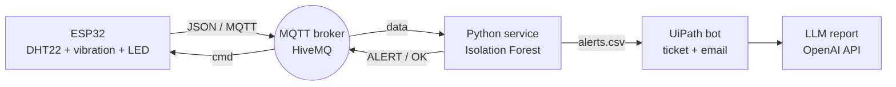

# Smart Machine Health Monitor


A predictive-maintenance prototype that closes the loop from sensor to ticket. An **ESP32** reads machine temperature and vibration and publishes them over **MQTT**. A **Python service** detects anomalies with an **Isolation Forest** and commands the device back. An **RPA bot (UiPath)** turns every alert into a maintenance ticket and email draft, and an **LLM (OpenAI API)** writes a short maintenance report for each ticket.

> **Status:** Prototype. Hardware is simulated in [Wokwi](https://wokwi.com). Next step is running the same firmware on a real ESP32 with a DHT22 and an MPU6050.


## Table of contents

1. [Problem](#problem)
2. [How it works](#how-it-works)
3. [Architecture](#architecture)
4. [Tech stack](#tech-stack)
5. [Repository structure](#repository-structure)
6. [Setup and run](#setup-and-run)
7. [MQTT topics and message format](#mqtt-topics-and-message-format)
8. [Design decisions](#design-decisions)
9. [Testing and results](#testing-and-results)
10. [Limitations](#limitations)
11. [Future work](#future-work)
12. [Author](#author)
13. [License](#license)

## Problem

Machines are usually serviced on a fixed schedule or after they fail. Unplanned downtime is expensive, yet small signs such as rising temperature or abnormal vibration often appear before a breakdown. This project detects those signs automatically and starts the maintenance process without manual effort.

## How it works

1. **Sense:** the ESP32 reads temperature (DHT22) and vibration (analog input) every 2 seconds.
2. **Transmit:** readings are published as JSON over MQTT.
3. **Detect:** a Python service learns "normal" behavior and flags anomalies using an Isolation Forest.
4. **Act:** the service sends an `ALERT` command back to the ESP32, which switches on an LED (actuator).
5. **Log:** anomalies are written to `alerts.csv`.
6. **Automate:** a UiPath bot reads new alerts and creates maintenance tickets and an email draft.
7. **Explain:** an LLM (OpenAI API) writes a short maintenance report for each ticket.

## Architecture




## Tech stack

| Area | Tools |
|---|---|
| Embedded | C/C++ (Arduino framework), ESP32, DHT22, ADC, GPIO |
| IoT | MQTT (PubSubClient, paho-mqtt), JSON, Last Will, retained messages |
| Python / ML | Python 3, scikit-learn (Isolation Forest), pandas |
| RPA | UiPath Studio Community Edition |
| AI | OpenAI API |
| Simulation | Wokwi |

## Repository structure

```text
smart-machine-health-monitor/
├── firmware/
│   ├── esp32_monitor.ino        # ESP32 firmware
│   └── wokwi/                   # diagram.json, platformio/wokwi config
├── python/
│   ├── subscriber.py            # MQTT subscriber + anomaly detection
│   ├── report.py                # LLM maintenance report
│   └── requirements.txt
├── rpa/
│   └── AlertToTicket/           # UiPath project
├── data/
│   ├── alerts.csv               # generated at runtime
│   └── maintenance_tickets.xlsx
├── docs/
│   ├── architecture.png
│   └── demo.gif
└── README.md
```

## Setup and run

### Prerequisites

- A free [Wokwi](https://wokwi.com) account (or a real ESP32 + DHT22 + potentiometer/accelerometer)
- Python 3.8+
- UiPath Studio Community Edition
- An OpenAI API key (for the report step)

### 1. Firmware (Wokwi)

1. Create a new ESP32 project at [wokwi.com](https://wokwi.com).
2. Add a **DHT22** (data pin to GPIO 15), a **potentiometer** (signal to GPIO 34, used as the vibration sensor) and an **LED** (GPIO 2).
3. Install the libraries `PubSubClient` and `DHT sensor library`.
4. Paste `firmware/esp32_monitor.ino` and start the simulation.

### 2. Python service

```bash
cd python
pip install -r requirements.txt
python subscriber.py
```

Keep the sensors at normal values for about 2 minutes. The first 60 readings are used to train the model. After that, raise the temperature or vibration in Wokwi to trigger an alert.

### 3. UiPath bot

1. Open `rpa/AlertToTicket` in UiPath Studio.
2. Set the path to `data/alerts.csv`.
3. Run the workflow. Rows with status `PENDING` become tickets, and their status changes to `TICKET_CREATED`.

### 4. LLM report

```bash
export OPENAI_API_KEY="your-key"     # Windows: set OPENAI_API_KEY=your-key
python report.py
```

> **Never commit your API key.** Keep it in an environment variable or a `.env` file listed in `.gitignore`.

## MQTT topics and message format

| Topic | Direction | Payload |
|---|---|---|
| `madhu/factory/m1/data` | ESP32 → broker | `{"temp": 28.4, "vib": 1520}` |
| `madhu/factory/m1/cmd` | Python → ESP32 | `ALERT` or `OK` |
| `madhu/factory/m1/status` | ESP32 → broker | `online` (retained), `offline` (Last Will) |

The public HiveMQ broker is used for the demo. Topic names are prefixed to avoid collisions. Public brokers are not secure and must not be used for real data.

## Design decisions

| Decision | Reason |
|---|---|
| MQTT instead of HTTP | Lightweight publish/subscribe, suited to constrained devices and continuous updates |
| `millis()` instead of `delay()` | Non-blocking loop, so MQTT keepalive and incoming commands keep working |
| Last Will + retained status | Subscribers can tell when a device drops off unexpectedly |
| Sensor error check (`isnan`) | Bad readings are skipped instead of being sent to the model |
| Isolation Forest | Unsupervised, so it needs no labeled failure data, which is rare in real machines |
| Training on the first 60 readings | Simple way to learn a baseline per machine in a prototype |
| Command sent back to the device | Closes the loop: sense, decide, act |
| CSV as the hand-off to RPA | Simple, inspectable interface between the Python service and UiPath |

## Testing and results

Measured in the Wokwi simulation. Replace the blanks with your own recorded numbers before publishing.

| Test | Method | Result |
|---|---|---|
| Normal operation | 2 minutes of steady readings | ___ false alerts in ___ readings |
| Injected temperature spike | Raise temperature in Wokwi | Detected in ___ of ___ trials |
| Injected vibration spike | Raise potentiometer value | Detected in ___ of ___ trials |
| Publish interval | Observed on MQTT client | Every 2 s |
| Device offline | Stop the simulation | `offline` status received via Last Will |

## Limitations

- Hardware is simulated. Real sensors will add noise, calibration and wiring issues.
- Vibration is represented by a potentiometer, not a real accelerometer.
- The model is trained on a short baseline and only uses two features. It does not model drift or operating modes.
- Public MQTT broker, no TLS or authentication.
- The pipeline handles one machine. Scaling needs per-device topics, a database and a managed broker.

## Future work

- [ ] Run on a real ESP32 with a DHT22 and an MPU6050 accelerometer
- [ ] Compute vibration features (RMS, FFT peaks) instead of a raw analog value
- [ ] Add TLS and per-device credentials, and use a private broker (Mosquitto)
- [ ] Store data in InfluxDB and build a Grafana dashboard
- [ ] Add Modbus RTU/TCP input for PLC data
- [ ] Signed OTA firmware updates
- [ ] Persist and retrain the model periodically

## Author

**Malleswari D**, B.Sc. Computer Science, University of Madras

[GitHub](https://github.com/malleswari123321) · [LinkedIn](https://linkedin.com/in/malleswari-d-5096682b1)

## License

Released under the [MIT License](LICENSE).
